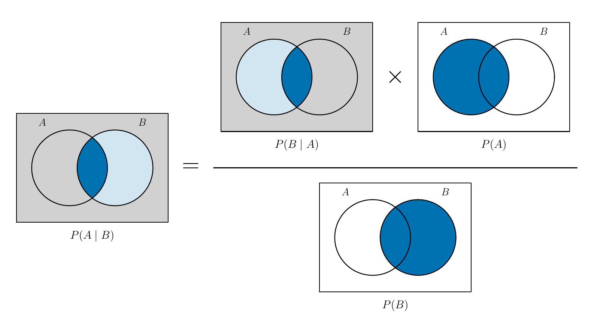
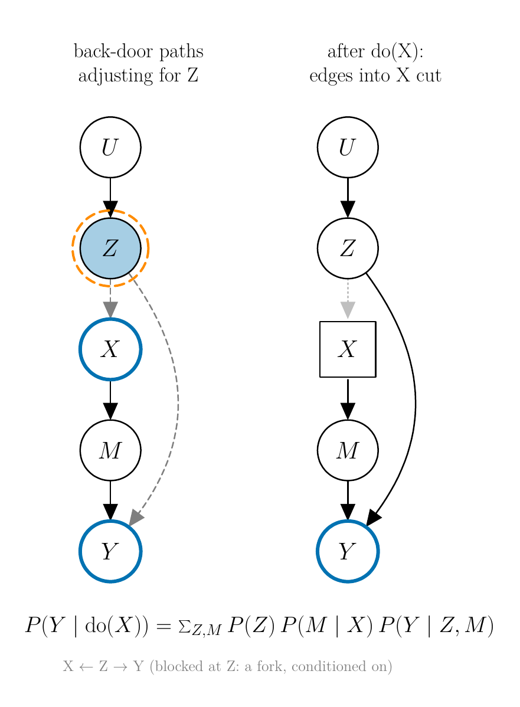
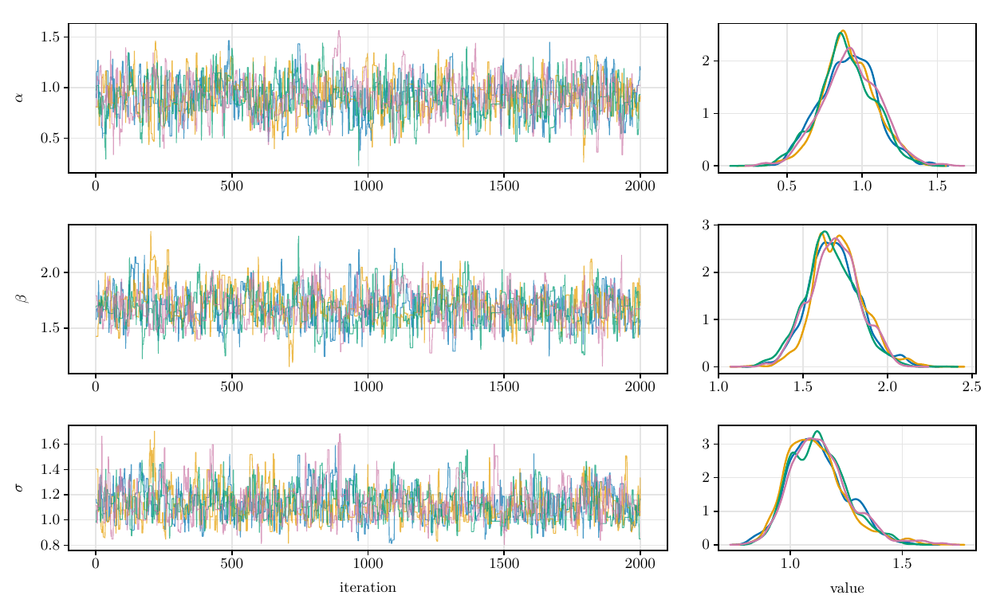

PracticalProbability draws its diagrams (DAGs, Venn diagrams, probability
trees, mosaics and plots of factors) with
[PracticalBayesPlot](https://github.com/EvoArt/PracticalBayesPlot.jl), a small
plotting package with no dependencies that writes SVG, TikZ and CeTZ. Nothing
has to be loaded besides the package itself: no Makie, no Cairo, no GPU.
Figures show up inline wherever SVG does (VS Code's plot pane, Jupyter, Pluto,
Quarto), and the same figure can be saved as a TikZ picture whose text LaTeX
typesets, or as a CeTZ drawing for Typst.

PracticalBayesPlot's API follows Makie's (`Figure`, `Axis`, `lines!`,
`poly!`, ...), and it also draws the plots of the Bayesian workflow: trace
plots, posterior densities, intervals and posterior predictive checks. The
last part of this document fits a model and plots its posterior samples, both
as distributions and as events.

```{julia}
#| output: false
using PracticalProbability
import PracticalBayesPlot as PBP
using Random
```

```{julia}
plotbackend()
```

With a Makie backend loaded (`using CairoMakie`), the same functions return
Makie figures instead; `plotbackend!(:pbp)` or `plotbackend!(:makie)` chooses
explicitly.

# Causal graphs

`dagplot` draws a DAG in layers, parents above children.

```{julia}
@rv U Z X Y M
g = @dag begin
    U → Z
    Z → (X, Y)
    X → M → Y
end
dagplot(g)
```

Given an independence statement, every path between the two sides is drawn
and classified. Open paths are red; blocked paths are dashed grey, with the
node that blocks them ringed. The caption says whether the statement holds.

```{julia}
dagplot(g, X ⟂ Y | Z)
```

```{julia}
dagplot(g, X ⟂ Y | (Z, M))
```

For an interventional query, the left panel shows the back-door paths and the
adjustment set that closes them; the right panel the graph after surgery,
with the edges into the intervened variable cut. The caption is the
identified formula.

```{julia}
dagplot(g, P(Y | Do(X)))
```

A generative model is drawn in plate notation: observed variables are shaded,
inputs are small dots, and repeated variables sit in labelled plates. Here is
the eight-schools model (only read, not run, so no distributions package is
needed):

```{julia}
schools = @generative function schools(J, y, sigma)
    mu ~ Normal(0, 5)
    tau ~ truncated(Cauchy(0, 5); lower=0)
    for j in 1:J
        theta[j] ~ Normal(mu, tau)
        y[j] ~ Normal(theta[j], sigma[j])
    end
end
dagplot(schools)
```

# Events: Venn diagrams

Each probability term `P(E | C)` is one panel. The cells of `E ∩ C` are
filled, the rest of `C` is tinted, and the sample space outside `C` is greyed
out. Sums, products, quotients and equations keep their shape.

```{julia}
@event A B C
venn(P(A ∩ B' | C))
```

```{julia}
venn(Equation(P(A ∪ B), inclusion_exclusion(P(A ∪ B))))
```

Bayes' rule as a fraction of panels:

```{julia}
venn(Equation(P(A | B), bayes(P(A | B))))
```

Two values of the same variable never happen together, so that cell is
hatched:

```{julia}
@rv W
venn(P(W(1) ∪ W(2)))
```

With numbers (here facts, in the form `deduce` takes), cells carry their
probabilities and each panel its value:

```{julia}
venn(Equation(P(A ∪ B), inclusion_exclusion(P(A ∪ B)));
     facts = (P(A) => 0.3, P(B) => 0.5, P(A ∩ B) => 0.1), cellvalues = :all)
```

# Probability trees and mosaics

A diagnostic test: 1% prevalence, 95% sensitivity, 5% false positives.

```{julia}
@event Disease Positive
test = BayesNet(Disease => 0.01, (Positive | Disease) => [0.95, 0.05])
probtree(P(Disease | Positive); bn = test)
```

The leaves are coloured like Venn panels, and the caption works out
`P(Disease | Positive)` from them. A mosaic shows the same with areas to
scale: the answer is the blue area over the blue and tinted area.

```{julia}
mosaic(P(Disease | Positive); bn = test)
```

# Factors

`compute` returns a `Factor` for a query about random variables;
`factorplot` draws it as bars, grouped bars or a heatmap.

```{julia}
@rv Rain Sprinkler Grass
weather = BayesNet(
    Rain => [0.8, 0.2],
    (Sprinkler | Rain) => [0.6 0.99; 0.4 0.01],
    (Grass | (Sprinkler, Rain)) => cat([1.0 0.2; 0.0 0.8], [0.1 0.01; 0.9 0.99]; dims=3);
    domains = Dict(Rain => [:dry, :wet], Sprinkler => [:off, :on], Grass => [:dry, :wet]),
)
factorplot(compute(P(Grass | Rain), weather))
```

```{julia}
factorplot(compute(P(Grass | Rain), weather); kind = :heatmap)
```

```{julia}
factorplot(compute(P(Grass, Rain, Sprinkler), weather))
```

# Posterior samples

A linear regression, fitted with a few lines of random-walk Metropolis (four
chains), so that this document needs nothing but the two packages:

```{julia}
rng = Xoshiro(2026)
n = 40
x = collect(range(-2, 2; length = n))
y = 1.0 .+ 1.6 .* x .+ 1.1 .* randn(rng, n)

# log posterior of (α, β, log σ): α, β ~ Normal(0, 10), σ ~ Exponential(1)
function logpost(θ)
    α, β, logσ = θ
    σ = exp(logσ)
    lp = -(α^2 + β^2) / 200 - σ + logσ
    return lp - n * logσ - sum(abs2, y .- α .- β .* x) / (2σ^2)
end

function metropolis(rng, θ, iters; step = [0.25, 0.2, 0.15])
    lp = logpost(θ)
    out = Matrix{Float64}(undef, iters, 3)
    for i in 1:iters
        prop = θ .+ step .* randn(rng, 3)
        lq = logpost(prop)
        if log(rand(rng)) < lq - lp
            θ, lp = prop, lq
        end
        out[i, :] = θ
    end
    return out
end

chains = [metropolis(rng, [2randn(rng), 2randn(rng), 0.0], 3000)[1001:end, :] for _ in 1:4]
draws = (α = reduce(hcat, (c[:, 1] for c in chains)),
         β = reduce(hcat, (c[:, 2] for c in chains)),
         σ = reduce(hcat, (exp.(c[:, 3]) for c in chains)))
size(draws.α)    # iterations × chains
```

The model's graph, read from its source:

```{julia}
linreg = @generative function linreg(x, y)
    α ~ Normal(0, 10)
    β ~ Normal(0, 10)
    σ ~ Exponential(1)
    μ = α .+ β .* x
    y .~ Normal.(μ, σ)
end
dagplot(linreg)
```

## The Bayesian workflow plots

Trace plots and per-chain densities: the chains mix and agree.

```{julia}
PBP.traceplot(draws)
```

Posterior intervals (50% and 90%) and medians:

```{julia}
PBP.intervals(draws)
```

Posterior predictive checks: data replicated from 100 posterior draws against
the observed data.

```{julia}
idx = rand(rng, 1:length(draws.α), 100)
yrep = [draws.α[k] + draws.β[k] * x[i] + draws.σ[k] * randn(rng) for k in idx, i in 1:n]
PBP.ppcheck(y, yrep; type = :dens_overlay)
```

```{julia}
PBP.ppcheck(y, yrep; type = :stat)
```

## Events defined on the draws

`@sampleevents` turns conditions on the draws into events, and every diagram
above then works on them, with probabilities estimated by the share of draws.
Is a steep slope more likely when the noise is large?

```{julia}
flat = (α = vec(draws.α), β = vec(draws.β), σ = vec(draws.σ))
se = @sampleevents flat begin
    Steep = β > 1.6
    Noisy = σ > 1.1
end
compute(P(Steep | Noisy), se), compute(P(Steep), se)
```

```{julia}
venn(Equation(P(Steep | Noisy), bayes(P(Steep | Noisy))); samples = se, cellvalues = :all)
```

```{julia}
probtree(P(Steep | Noisy); samples = se)
```

```{julia}
mosaic(P(Steep | Noisy); samples = se)
```

## Building your own figures

The diagram functions have `!` forms that draw into any PracticalBayesPlot
`Axis`, so diagrams and data plots can share a figure. Diagram axes want
`aspect = DataAspect()` (round circles) and no decorations.

```{julia}
#| echo: false
#| output: false
median(v) = (s = sort(vec(v)); n = length(s); isodd(n) ? s[(n + 1) ÷ 2] : (s[n ÷ 2] + s[n ÷ 2 + 1]) / 2)
```

```{julia}
fig = PBP.Figure(; size = (760, 330))
ax1 = PBP.Axis(fig[1, 1]; aspect = PBP.DataAspect(), title = "model")
dagplot!(ax1, linreg)
PBP.hidedecorations!(ax1); PBP.hidespines!(ax1)

ax2 = PBP.Axis(fig[1, 2]; title = "fit", xlabel = "x", ylabel = "y")
xs = collect(range(-2.2, 2.2; length = 50))
fits = [draws.α[k] .+ draws.β[k] .* xs for k in idx]
lo = [sort(getindex.(fits, i))[6] for i in eachindex(xs)]
hi = [sort(getindex.(fits, i))[95] for i in eachindex(xs)]
PBP.band!(ax2, xs, lo, hi; label = "90% of fits")
PBP.lines!(ax2, xs, median(draws.α) .+ median(draws.β) .* xs; color = :black, label = "median fit")
PBP.scatter!(ax2, x, y; color = :black, markersize = 5, label = "data")
PBP.axislegend(ax2; position = :lt)
PBP.colsize!(fig, 1, PBP.Relative(0.32))
fig
```

The primitives are the usual ones (`lines!`, `scatter!`, `band!`,
`barplot!`, `hist!`, `density!`, `heatmap!`, `poly!`, `text!`, ...), and
`text!` takes `markerspace = :data` for text that scales with the plot.

# TikZ for LaTeX

Every figure can also be written as a `tikzpicture`. Its text is typeset by
LaTeX, in the document's font, and the diagrams pass their labels in LaTeX
form, so `P(A ∣ B)` comes out as real mathematics.

```{julia}
mkpath("plotting-tikz")
PBP.save("plotting-tikz/bayes.tex", venn(Equation(P(A | B), bayes(P(A | B)))))
PBP.save("plotting-tikz/backdoor.tex", dagplot(g, P(Y | Do(X))))
PBP.save("plotting-tikz/trace.tex", PBP.traceplot(draws); standalone = true)   # a complete document
t = PBP.tikz(probtree(P(Disease | Positive); bn = test))
print(first(t, 700), "…")
```

The picture needs only `\usepackage{tikz}` (and a scalable font such as
`lmodern` for exact sizes); `\input{bayes.tex}` puts it in a document. Compiled
with pdfLaTeX, the three files above look like this:

{width=95%}

{width=60%}

{width=95%}

# CeTZ for Typst

The same figures can be written as Typst code that draws them with the
[CeTZ](https://typst.app/universe/package/cetz) package, so that a Typst
document sets their text in its own font. Labels are written as plain text
(Typst gets `P(A ∣ B)`, not the LaTeX form).

```{julia}
mkpath("plotting-cetz")
PBP.save("plotting-cetz/backdoor.typ", dagplot(g, P(Y | Do(X))))
PBP.save("plotting-cetz/mosaic.typ", mosaic(P(Disease | Positive); bn = test))
print(first(PBP.cetz(venn(P(A | B))), 500), "…")
```

`#include "backdoor.typ"` places a drawing in a Typst document. The PDF
version of this page is made with Typst, so the two drawings below are the
CeTZ files themselves, not pictures of them (the HTML version has no Typst):

::: {.content-visible when-format="typst"}
```{=typst}
#align(center, scale(70%, reflow: true, include "plotting-cetz/backdoor.typ"))
#align(center, scale(70%, reflow: true, include "plotting-cetz/mosaic.typ"))
```
:::

# Cost

Measured on a compute node of a Linux cluster (Julia 1.12, a fresh process
each time; medians of five runs for PracticalBayesPlot, and the faster of two
runs for CairoMakie, the other being slower from a cold file cache):


